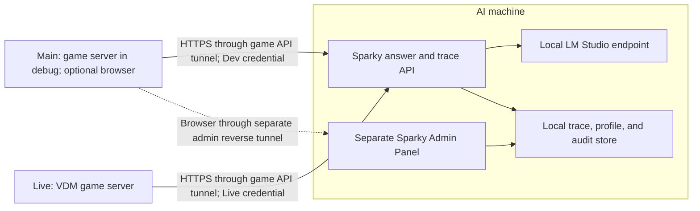

# Sparky Admin Panel and Tuning Design

**Status:** Draft for user review
**Date:** 2026-10-14

## Goal

Provide a separate local administration panel for reviewing Sparky interactions, diagnosing routing and delivery issues across machines, and tuning supported behavior without rebuilding or restarting Sparky for every correction.

The panel supports the existing three-machine arrangement:

- **AI** runs the Sparky answer service and the admin panel.
- **Main** runs the game server during local development and can host a browser used to access the panel.
- **Live** runs the production game server on VDM.

Main testing and Live operation use separate configuration and knowledge-bundle profiles. Testing on Main must not silently change Live behavior.

## Current State and Need

- The Sparky answer service runs on AI and exposes its HTTPS API on IPv4 loopback. An AI-initiated reverse SSH tunnel makes that API available on the selected game host.
- Main/Live and AI currently write separate log entries. The game-side request sequence and AI HTTP trace identifier are not a shared end-to-end correlation ID.
- The AI service loads one configuration and one active knowledge bundle at startup. Routing, retrieval, and response behavior are primarily code-defined.
- The existing passive question-capture feature writes local JSONL on the game host. It is separate from answered Sparky requests and is not a joined diagnostic journal.
- `Perpetuum.AdminTool` is a WPF application for game administration and database content operations. The Sparky panel is a separate application and does not query the game database.

These boundaries make it difficult to tell whether an issue occurred in trigger detection, game queueing, interpretation, retrieval, answer generation, or delivery. They also make small routing corrections depend on code changes and publishing.

## Approved Decisions

- Build a separate browser-based Sparky Admin Panel, distinct from `Perpetuum.AdminTool`.
- Host the panel on AI. Use it on AI locally or on Main through a dedicated, restricted reverse SSH tunnel initiated by AI to Main.
- Keep the game API tunnel independent from the admin-panel access tunnel. Do not expose either service to the public internet or add a third-party relay.
- Maintain isolated **Dev** and **Live** profiles. Main uses Dev; Live uses Live. Promotion from Dev to Live is explicit and reversible.
- Join game-side and AI-side diagnostics with one request correlation ID.
- Persist game-side diagnostic events locally until the AI service acknowledges them. Keep a central Sparky trace journal on AI.
- Add operator feedback and replay/evaluation tools. Feedback never changes production automatically.
- Do not send account or character IDs to the AI machine or store them in the trace journal.

## Topology

The Sparky API and panel bind only to IPv4 loopback on AI. The game API tunnel continues to expose only the answer/trace API on a game host's loopback. A separate AI-to-Main reverse SSH connection exposes the panel to a loopback-only port on Main. That connection uses a dedicated restricted key and does not share the game API listener or credentials.

The API authenticates each environment with a distinct protected credential. The credential selects Dev or Live; a caller-supplied profile name is not trusted. The same AI instance may serve whichever configured profiles are connected. Main and Live connections can be enabled or stopped independently.

The panel has its own admin authentication in addition to the SSH tunnel. The admin API is not authorized by the game API bearer token. The panel is unavailable from the game API tunnel and does not provide shell, arbitrary file, or database access.

## Request Trace and Logging

### Correlation

The game server creates a cryptographically random request ID when it accepts a Sparky request. It sends that ID with the request to AI. AI uses the same ID for interpretation, retrieval, model, and service events. The game server attaches it to the final result and delivery event.

Events are idempotent and include a unique event ID, UTC timestamp, request ID, environment, component, stage, outcome, and bounded structured fields. Retries of an unacknowledged event must not create duplicate timeline entries.

### Trace stages

The timeline should distinguish:

- game/Discord trigger recognized, request queued, rejected, or dropped;
- API request accepted, rejected, busy, timed out, or unavailable;
- interpreted intent, focus, normalized search query, and resolved entity candidates;
- selected route, retrieval source IDs, candidate scores/decision category, and fallback outcome;
- model identifier, bundle version, configuration revision, finish status, and elapsed time;
- structured answer result returned to the game server;
- game chat, in-game mail, or Discord delivery attempted and completed or failed.

Capture structured diagnostics, not arbitrary game logs. The panel may display Sparky-category service, tunnel, and model-availability events, but must not ingest all server logs by default. Do not record hidden model reasoning or full prompts; record prompt/config revision identifiers and selected source IDs.

### Content and privacy

- Caller platform (`Game` or `Discord`), environment, channel label when available, and question/answer content can be shown in the trace.
- Dev content capture is enabled by default for local tuning. Live content capture is explicitly controlled by a per-profile setting and is off by default until an operator enables it.
- Content retention is configurable separately from metadata retention. The initial proposed defaults are 30 days for question/answer content and 90 days for metadata; both are subject to operator configuration and review.
- Omit account IDs, character IDs, Discord user IDs, session state, API tokens, SSH key material, and LM Studio credentials. Do not join game and Discord identities.
- Text itself may contain a player-typed name or other personal information. Keep the trace store local to AI, protect it with the Sparky service ACL, and apply configured expiration/deletion.
- Content capture can be disabled without disabling Sparky or metadata tracing.

### Durable local spool

The game host writes accepted Sparky trace events to a local, bounded spool before considering them safely queued for transfer. A background uploader sends events over the existing authenticated HTTPS game API tunnel and removes them only after acknowledgment. Store the spool under the game server's protected data/log directory, not in the ordinary public chat log. Preserve pending events across game-server and AI-service restarts. Apply idempotent ingestion on AI.

Spooling and upload must not block zone updates, chat delivery, Discord callbacks, or inference workers. If the spool reaches its configured disk bound, emit a clear operational warning and preserve the request/answer flow; do not silently discard events. The implementation plan must define the exact overflow policy and ensure the panel reports any trace gap.

The AI-side trace store is local to AI and independent of the game's SQL Server database. A local embedded store (proposed: SQLite) is appropriate for searchable traces, feedback, and revisions; it must not require a separate database service or live game DB access.

## Profiles, Hot Configuration, and Promotion

### Profile contents

Dev and Live each have an immutable revision containing:

- routing rules for already implemented intents, language-specific phrasing, aliases, exclusions, and priorities;
- retrieval controls such as source categories, boosts, candidate limits, and fallback thresholds;
- editable persona/style guidance, answer length, and formatting preferences;
- supported model ID and bounded inference settings;
- the selected validated knowledge-bundle version;
- content-capture and retention settings.

The non-editable code layer continues to own API authentication, privacy rules, safe input bounds, source-grounding requirements, domain calculations, network restrictions, and delivery behavior. The panel does not accept scripts, arbitrary code, SQL, or unrestricted regular expressions. Rules use a versioned and validated schema; a request that refers to a feature not implemented in code cannot create that feature by configuration alone.

Knowledge bundles are produced from the existing offline export flow on Main and transferred to AI. The panel can show bundle versions, validate/stage a bundle for Dev, and promote that exact bundle version to Live. Bundle creation never queries the Live database. The panel retains the prior active version for rollback.

### Apply behavior

- Configuration and bundle revisions are immutable and carry stable revision/version IDs.
- The panel validates a draft before activation and shows the validation errors without disturbing the active revision.
- Activating a revision applies atomically without restarting either the AI service or game server. An in-flight request continues with the immutable revision it started with; later requests use the new revision.
- Every trace records the exact profile, config revision, bundle version, and model ID it used.
- Dev changes affect only Dev. Live changes happen only through an explicit promotion action showing the exact source and destination revisions.
- Retain a revision history and an explicit one-step rollback for each profile. Record the admin actor, timestamp, changed fields, and reason for activation/promotion/rollback.
- Invalid configuration, an unavailable model, or a bundle validation failure leaves the current active revision intact.

If a new intent, entity calculation, or delivery capability is not already supported by the deployed code, the panel must explain that a code release is required rather than accepting a configuration that appears active but cannot work.

### Resource isolation

Dev and Live share the local LM Studio machine. The API retains bounded concurrency and request limits. Dev traffic must not consume unbounded inference capacity or queue space needed by Live. Profile-specific limits and a bounded queue are configurable, while global safety limits remain code-owned.

## Panel Workflows

### Trace review

Filter by time, environment, source platform, route/outcome, and feedback label. Open one request to see its end-to-end timeline, question/answer when content capture is enabled, the configuration and bundle revisions, source IDs, and delivery result. The panel distinguishes missing trace stages from a complete request rather than presenting partial data as complete.

### Feedback and evaluation corpus

An operator can label an interaction as one or more of: wrong intent/route, missed entity, retrieval miss, incorrect fact, language/translation, style/format, context/follow-up, delivery, or infrastructure. A label can include a human note. A reviewed trace can be added to a local evaluation corpus with an expected intent/route or expected answer properties.

Feedback is evidence for a human to edit rules. It does not train model weights, create rules, or change the active profile automatically.

### Replay and compare

Run selected evaluation examples against a draft revision. Show route/intent, entity resolution, selected source IDs, structured result, and answer side by side for the active and draft revisions. Highlight regressions and require the operator to save/promote explicitly. Replay must not post to game chat or Discord, and it must not contact the Live game server or database.

### Diagnostic export

Export a selected trace or bounded time range as sanitized JSON suitable for local review. Include the event timeline, effective configuration revision, relevant source IDs, model/bundle metadata, feedback, and redacted errors. Exclude credentials, player IDs, raw chat-channel IDs, hidden model reasoning, and unrelated game logs. The operator can choose whether captured question/answer content is included.

### Operations view

Show AI Sparky service health, LM Studio reachability/model ID, active bundle versions, profile revisions, game API tunnel status per configured environment, the separate Main admin tunnel status, pending spool counts when reported, and the most recent event time per environment. Health details must not expose secrets.

## Security and Failure Behavior

- No public listener, router port forwarding, VPN, third-party relay, or direct inbound connection to AI is added.
- Keep the game API loopback-bound and authenticated. Dev and Live use separate bearer credentials stored in the existing protected settings mechanism.
- Keep the panel loopback-bound and use separate admin authentication. HTTPS certificate validation remains enabled. The reverse SSH tunnel is restricted to the exact loopback panel port, with no shell, PTY, agent forwarding, or unrelated forwarding.
- The Main panel tunnel is independent from the game API tunnel. If Main or that tunnel is down, the panel remains available locally on AI. If AI or the game API tunnel is down, game-side events remain spooled locally.
- On reconnection, event upload resumes and deduplicates acknowledged records. A permanently invalid credential must be surfaced in the operations view without logging the credential.
- Storage is protected by Windows ACLs for the Sparky service/admin identities. Apply configured retention and report deletion failures.
- The panel cannot read or write arbitrary paths, execute commands, query the game database, or inspect account/character records.
- If the central store is unavailable, answer and delivery behavior should continue where possible; local game spools retain events for later upload. The AI service logs an operational store error without exposing request content.

## Implementation Slices

1. **Trace foundation:** add a shared request ID and profile identity to the game-to-AI contract, structured trace events on both hosts, durable local spool/uploader, and an AI-side searchable journal. The initial panel view is read-only and includes health/tunnel state.
2. **Profile and hot-reload support:** introduce separate Dev/Live config and bundle references, protected environment credentials, atomic validated activation, audit history, and rollback. Add the panel editor for supported settings.
3. **Training workflow:** add feedback labels, saved evaluation examples, draft replay/compare, explicit Dev-to-Live promotion, and sanitized diagnostic export.

Keep implementation and validation on Main/AI first. No Live VDM installation, configuration change, or restart is included in this design approval. A separate rollout decision is required after the feature is implemented and reviewed.

## Acceptance Checks

1. A Main Dev request and a Live request authenticate to their respective profiles. A request cannot select Live by changing an untrusted profile field.
2. A single request ID joins the game trigger, AI interpretation/retrieval/model outcome, game response, and final delivery events. Discord and game origins remain distinguishable without storing caller IDs.
3. A game-server or AI-service restart during an outage does not lose already spooled events. Reconnection delivers each event once in the trace timeline.
4. The panel opens on AI locally and on Main through the dedicated reverse SSH tunnel. The panel is inaccessible through the game API port and from non-loopback network interfaces.
5. A routing/style/retrieval edit to Dev is validated and becomes active for later requests without restarting Sparky; Live remains unchanged.
6. Invalid configuration leaves the active revision unchanged. In-flight requests retain the revision they started with.
7. Promotion shows the exact Dev config and bundle versions going to Live, records an audit entry, and can be rolled back.
8. Feedback labels and replay comparisons do not alter active configuration or post messages to players.
9. Content capture can be toggled independently by profile. Retention removes expired content, while metadata follows its separate retention setting.
10. The panel reports AI health, LM Studio status, per-environment game tunnel state, Main admin tunnel state, and pending spool/trace gaps without exposing secrets.
11. Diagnostic export can exclude question/answer text and contains no account IDs, character IDs, Discord user IDs, API tokens, SSH key material, or hidden model reasoning.
12. No Sparky panel or trace feature queries the Live SQL Server database.

## Out of Scope

- Automatically training or fine-tuning model weights from player feedback.
- Automatically changing rules or promoting changes from feedback.
- Arbitrary scripts, SQL execution, remote shell, general-purpose file browsing, or general server administration.
- Live database access, account/character lookup, player profiling, or identity linkage between game and Discord.
- Public internet exposure, VPN, third-party hosting/relay, or router port forwarding.
- Capturing all game/Discord chat or replacing the general game logging system.
- New game mechanics, unsupported intents, new domain calculations, or automatic code deployment.
- Live VDM rollout or service restart.

## Self-Review Notes

- Repository guidance was read from `CLAUDE.md`. Relevant existing Sparky API, service settings, game request coordinator, passive question-capture design, and prior Sparky design specs were reviewed.
- The proposed design reuses the existing AI-to-game reverse SSH/HTTPS pattern for request and trace traffic, while adding a separate AI-to-Main restricted tunnel solely for browser access to the panel.
- The design does not modify runtime code, the AI machine, the local database, the Live database, or VDM configuration.
- Risk: per-profile knowledge bundles and credentials change the current single-active-bundle/single-token service model. The implementation plan must preserve the existing bundle validator, atomic activation, and rollback behavior while scoping revisions by profile.
- Risk: the game-side durable spool adds disk lifecycle and backpressure concerns. Its size bound, retention, write-failure behavior, and upload retry policy must be explicit in implementation and must not block game processing.
- Risk: diagnostic question/answer capture can retain player-typed personal information. Dev and Live defaults, retention, access ACLs, and export redaction must be verified before Live enablement.
- Risk: the Main admin tunnel requires another restricted key/listen port and Windows OpenSSH configuration. It must be independently testable and must not weaken the existing game API tunnel restrictions.
